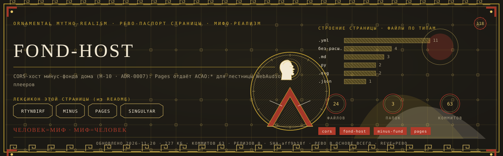

  

<!--ФОРЖ:МУЗА:НАЧАЛО-->

  

<!--ФОРЖ:МУЗА:КОНЕЦ-->

<!--ФОРЖ:ПАСПОРТ:НАЧАЛО-->

  

| ФАЙЛОВ | ПАПОК | КОММИТОВ | ОБНОВЛЕНО | РЕЛИЗОВ |
|---:|---:|---:|---|---:|
| 21 | 3 | 49 | 2026-11-19 | 0 |
<!--ФОРЖ:ПАСПОРТ:КОНЕЦ-->

# fond-host — CORS-хост минус-фонда дома

Единая роль тела: отдавать `minus/**` (чистый-минус 63 mp3, сборник 7 mp3 + ПАСПОРТ,
prosto-lubi) с заголовком `access-control-allow-origin: *`, чтобы лестница фонда
плееров дома (СИНГУЛЯР_01 и родня) жила кросс-доменно (Н-10 · ADR-0007).

- **Источник**: `rtynbirf/singulyar` ветка `minus-fond` (593 МБ, 72 файла).
- **Механика**: диспатч-воркфлоу материализует ветку в выкладку Pages (серверная
  загрузка — CORS в ней не участвует) и печатает `SHA256SUMS.txt` прямо в выкладке.
- **Приёмка**: проба `206 + ACAO` на живом файле (шаг «Приёмка прод» в воркфлоу).
- **Почему не релизные ассеты**: те не отдают ACAO (TH-AUDIO-44b, WebAudio-тишина,
  проба ×30).
- **Почему отдельное тело**: у выкладки singulyar свой бюджет Pages ≤ 1 ГБ при
  голосе 459 МБ (срез №3); здесь свой бюджет — фонд 593 МБ. LFS-квота не тратится.
- **Запуск**: только `workflow_dispatch` (запуск — СОБЫТИЕ, никогда — расписание).

База: `rtynbirf/repo-doctrine` + аккаунт-уровневые правила `rtynbirf/khozyain`.
